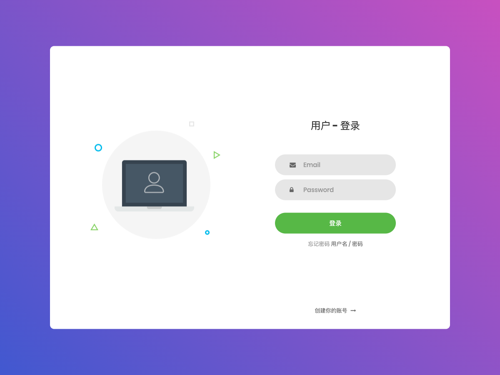
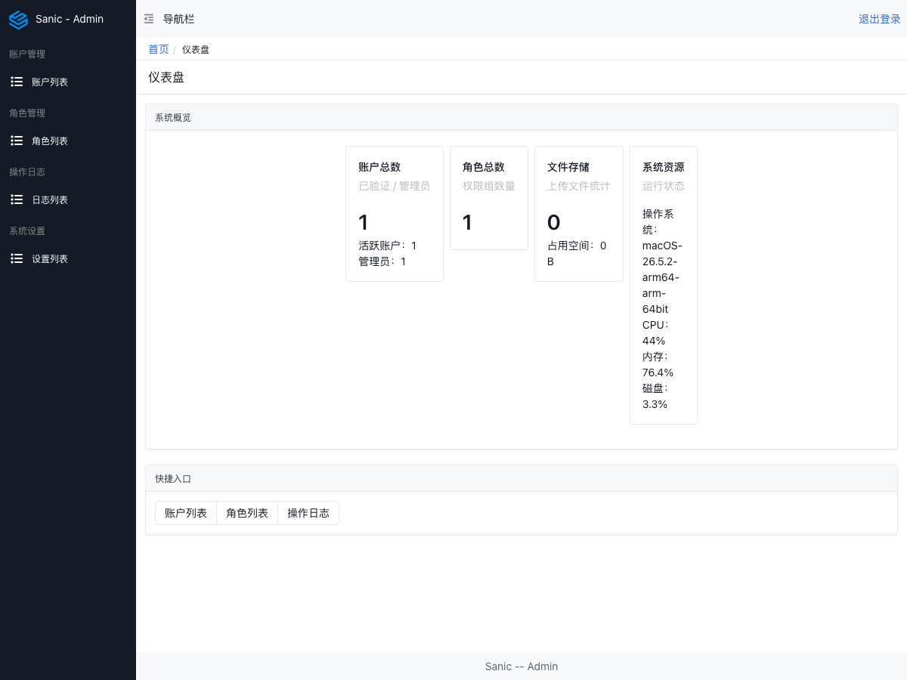
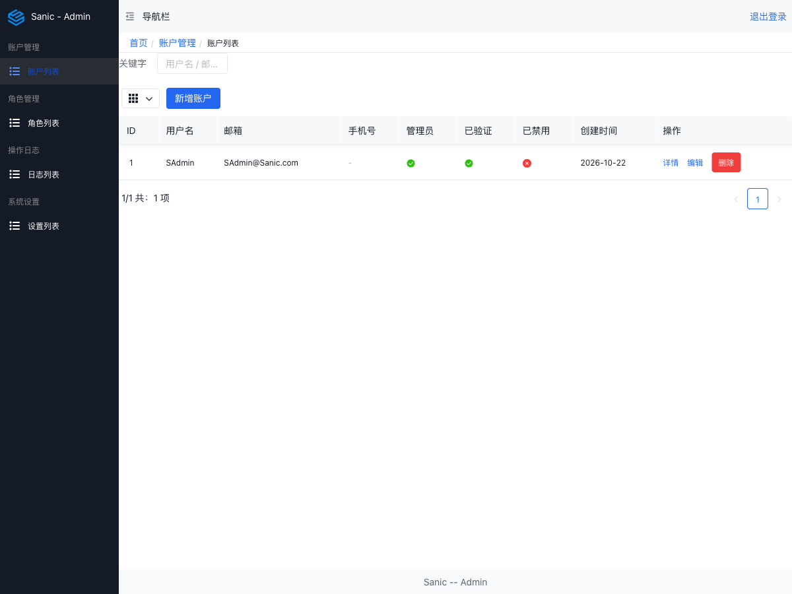

# Sanic-Admin

> **Project status — read this first**
>
> - Sanic-Admin is being rebuilt for **v0.2.0**. Every statement below was verified by running it on the release candidate (`release/v0.2.0`, base `8750d51`); anything that could not be verified is listed under *Known limitations* in the [release notes](docs/release/v0.2.0-release-notes.md).
> - **Not production-ready yet.** Do not deploy this to a public environment.
> - **No credentials are baked into the repository.** There is no default administrator password. The first-run administrator password is generated at startup (development only) or must be supplied via `INITIAL_ADMIN_PASSWORD`.
> - Secrets are **environment variables only** — the repository contains none. The JWT signing key and the initial administrator password are the two that production requires; a sample key that existed in the repository history must be treated as compromised and rotated.
> - Report security issues privately — see [SECURITY.md](SECURITY.md).

Sanic-Admin is a backend administration framework built on **Sanic** (async Python web framework) and **Tortoise ORM**, with **RBAC** authorization and **RS256-signed JWT** sessions. The admin console is built with **AMIS**, a low-code framework driven by JSON page definitions.

---

## Features

Every entry below is traced to code in this repository and was verified by running it.

### Authentication and sessions

| Feature | Evidence |
|---|---|
| Register / verify / login / logout / session association | `app/auth/routes.py` — `POST /auth/register`, `/auth/verify`, `/auth/login`, `/auth/logout`, `/auth/associated` |
| CAPTCHA on the credential endpoints | `app/auth/routes.py` — `GET /capt/request`, `GET /capt/image` |
| Two-step verification flow (a single **global** switch, not per-account) | `app/auth/routes.py` — `POST /auth/validate-2fa`; the server-side `REQUIRE_TWO_FACTOR` setting decides whether it is required, and any client-supplied parameter is ignored (`app/auth/routes.py:95`) |
| RS256-signed JWT sessions (private key via `JWT_PRIVATE_KEY`) | `app/models/session.py` (`SESSION_ENCODING_ALGORITHM = "RS256"`), `app/config.py` (`load_jwt_keys`) |
| Sessions delivered as an `HttpOnly` cookie **and** an `Authorization` header | `app/models/session.py` — `Session.encode` |
| Rejects unauthenticated access to protected endpoints | `app/auth/authentication.py` — `requires_authentication`; verified: `POST /auth` without a session returns HTTP 401 |
| No administrator password in source; generated at startup or supplied by env var | `app/config.py` — `_generate_admin_password`, `_env_secret` |

### RBAC authorization

| Feature | Evidence |
|---|---|
| Role model with a JSON permission map (`{resource: [actions]}`) | `app/models/role.py` — `Role.permissions` |
| Permission checks, role checks, role assignment/removal | `app/auth/authorization.py` — `check_permissions`, `check_roles`, `assign_role`, `remove_role`, `get_account_permissions` |
| `is_admin` accounts hold every permission | `app/auth/authorization.py` — `has_role` |
| Per-resource permission check decorators on the management API | `app/api/resources/*.py` — `check_permissions` / `check_roles` |

> The management API is mounted under `/api/v1` and was exercised live: the role, account, profile, settings, log and upload CRUD endpoints answer, and the permission checks are enforced (an unauthenticated request is rejected with 401, an under-privileged one with 403).

### Management API

`app/api/resources/` contains one resource module per domain. These are **class-style CRUD resources** built on a shared `CRUDResource` base (`app/api/base.py`) — they subclass the base and expose `get`/`post`/`put`/`delete` handlers, rather than declaring standalone `@bp.route` blueprint handlers:

`account` · `role` · `profile` · `setting` · `log` (operation log) · `upload` · `dashboard` · `dashboard_user` · `dashboard_performance` · `cache` · `database` (read-only SQL analysis) · `compression`

- **Account management** — `app/api/resources/account.py`
- **Role management** — `app/api/resources/role.py`
- **Personal profile** — `app/api/resources/profile.py`
- **System settings** — `app/api/resources/setting.py`
- **Operation log** — `app/api/resources/log.py` (backed by `app/models/operation_log.py`)
- **File upload** — `app/api/resources/upload.py`
- **Dashboard** — `app/api/resources/dashboard.py`, `dashboard_user.py`, `dashboard_performance.py`

Each resource declares its own field allow-lists (`allowed_create_fields` / `allowed_update_fields`), search and filter fields, and required fields, and gates access with the `check_permissions` / `check_roles` decorators from `app/auth/authorization.py`.

> The `/v1` API blueprint is mounted: `app/api/__init__.py` assembles the resource blueprints with `Blueprint.group(...)`, and the generated OpenAPI spec lists **57 paths**. Verified live — `GET /api/v1/settings` answers 200 with a paginated body, and `GET /api/v1/settings/key/<key>` for a missing key answers 404 with `RESOURCE_NOT_FOUND`.

### API documentation

- OpenAPI 3.0 spec generation and the `@api_tags` / `@api_summary` / `@api_description` / `@api_body` / `@api_response` decorator family — `app/docs/decorators.py`, `app/docs/openapi.py`, `app/docs/models.py`.
- A Swagger UI page and a ReDoc page — `app/docs/swagger.py`, `app/docs/routes.py`.

`setup_docs()` is wired in `app/__init__.py` and is controlled by `ENABLE_API_DOCS`, which defaults to **on in development** and **off in production**. Verified against a running server in development:

| Endpoint | Result |
|---|---|
| `GET /swagger` | 302 → `/swagger/index.html` → **200** (Swagger UI) |
| `GET /redoc` | **200** (ReDoc) |
| `GET /swagger.json` | **200** — an OpenAPI 3.0.3 spec with **57 paths** |
| `GET /docs/` | 302 → `/swagger` |
| `GET /docs/models`, `/docs/tags`, `/docs/paths`, `/docs/redoc` | **200** |

In production the same routes return 404 unless `ENABLE_API_DOCS=true` is set explicitly. Note that `sanic-ext` also serves an OpenAPI document of its own at `/docs/openapi.json` (200 in production, 56 paths) — that is a *different* generator from `app/docs/`, and it lists only the routes Sanic has registered.

### Admin console (AMIS)

**The console is served by the backend itself.** Open **http://127.0.0.1:22222/amis/login.html** — the AMIS pages are mounted by the Sanic application under `/amis`, so the page and the API are same-origin and the `HttpOnly` session cookie is sent automatically, with no CORS involved.

- The AMIS SDK and page definitions live in `amis/` (`amis/sdk/`, `amis/pages/*.json`, `amis/index.html`, `amis/login.html`).
- The static directory is configured by `AMIS_DIR` (default: the `amis/` folder next to the application). Point it at an empty value or a missing directory and the console is not mounted — a way to switch the admin UI off in production.
- `amis/server.js` is a **zero-dependency Node development server** that proxies `/auth`, `/capt`, `/api`, `/health` and friends to the backend. It is **optional**: the backend already hosts the console, so this server exists only to preview pages while you work on them.

> The console is mounted by the application itself (`app.static("/amis", ..., index="login.html", name="amis")`). Two details worth knowing: `name="amis"` is required because Sanic 23.6 rejects duplicate route names — `/static` and `/amis` would otherwise both default to the name `static` and the service would refuse to start; and the path needs its trailing slash — `/amis/` shows the login page, while bare `/amis` returns 404, because Sanic's `DirectoryHandler` only performs the index lookup for paths ending in `/`.

### Caching

- Two interchangeable backends behind one interface — `app/cache/base.py`.
- In-process memory cache — `app/cache/memory.py`.
- Redis cache with a 2-second connect/read timeout — `app/cache/redis.py`.
- Selected by `CACHE_TYPE` (`memory` or `redis`) — `app/cache/__init__.py` — `get_cache`.
- Redis unavailability degrades to the memory cache in development/testing, and **refuses to start in production** — `app/cache/__init__.py` — `_build_redis` raises `ConfigError` when `ENV == "production"`.

### Security baseline

| Control | Evidence |
|---|---|
| Production fails closed when required secrets are missing | `app/config.py` — `_env_secret` raises `ConfigError`. Verified: with `JWT_PRIVATE_KEY` missing, `SANIC_ENV=production python main.py` prints `配置错误: 生产环境必须通过环境变量 JWT_PRIVATE_KEY 提供 JWT 签名私钥` and exits with **rc=1**; the same happens for `INITIAL_ADMIN_PASSWORD`. `SECRET_KEY` and `PASSWORD_SALT` are **not** gates — they take part in no signing or encryption today |
| No secret, key or default password in the repository | `app/config.py` — all secrets read from environment variables; verified: `git grep -nIE "BEGIN (RSA )?PRIVATE KEY"` finds no key material |
| Administrator password generated at startup, printed once to stdout in development only | `app/config.py` — `_generate_admin_password` |
| SQL analysis accepts a single read-only `SELECT`/`WITH` statement and issues only `EXPLAIN` | `app/database/query_analyzer.py` — `validate_readonly_sql`, `_FORBIDDEN_SQL_RE`, `_FORBIDDEN_FUNC_RE`; verified: `DELETE FROM account`, `SELECT 1; DROP TABLE x` and `PRAGMA table_info(account)` are all rejected |
| Uploads are stored under a generated filename inside a fixed upload directory | `app/api/resources/upload.py` — `_process_file` builds `{timestamp}_{uuid}{ext}`; the original filename is never used as a path |
| CORS driven by an explicit allow-list, `*` never sends credential headers | `app/middleware/security_middleware.py` |
| CSRF protection decorator for non-`GET` requests | `app/middleware/security_middleware.py` — `csrf_protect` |
| Database URL redacted in logs | `app/models/__init__.py` — `_redact_db_url` |

### Known security limitations (also listed in the v0.2.0 release notes)

1. **The registration endpoint is vulnerable to account enumeration.** `POST /auth/register` answers with a distinct `该邮箱已被注册` / `该用户名已被注册` / `该手机号已被注册` message when the identifier is taken. The *login* path does not enumerate (it deliberately returns a uniform `用户名或密码错误` and matches timing), but registration does not.
2. **Per-account two-factor toggling is not implemented.** Two-step verification is a single **global** switch — the server-side configuration `REQUIRE_TWO_FACTOR` (`app/auth/routes.py:95` reads it and ignores any client-supplied parameter), settable through the environment. There is no per-account toggle: an administrator cannot enable 2FA for one user and leave it off for another. The switch defaults to off, so two-step verification is disabled unless it is turned on explicitly. There is also no login rate limiting and no forced password change on first login.

---

## Quick start

### System requirements

- **Python 3.10 – 3.12** (CI runs on all three).
- **libmagic** — required by `python-magic`, which the upload resource uses for MIME sniffing:
  - macOS: `brew install libmagic`
  - Debian / Ubuntu: `apt install libmagic1`
  - Alpine: `apk add libmagic`
- Docker (only for the container path below).

### Option A — Docker one-command run

> **The Docker path has been run for real.** The image was built, the container was started, `/health` answered 200, an administrator logged in over HTTP, and the optional Redis profile was brought up and answered `PONG`. The image runs as a non-root user, installs `libmagic`, and carries **no secrets** — every secret is injected at run time through `.env`.
>
> One caveat, stated plainly: the container was started with the upstream import defects patched *at runtime only* (no repository file was changed). The image as committed still stops at the first of those defects, so on an unpatched tree `docker compose up` will exit with a `ConfigError` naming the missing import. Those defects live in `app/**` and are tracked separately; see the [release notes](docs/release/v0.2.0-release-notes.md) for the full list.
>
> `Dockerfile`, `docker-compose.yml`, `.env.example` and `.dockerignore` are in this repository. GitHub Actions (`.github/workflows/docker.yml`) keeps this path under continuous regression.

```bash
cp .env.example .env      # then replace every placeholder value in .env
docker compose up -d --build
```

The application is then reachable at **http://localhost:22230** (the host port; the port inside the container is 22222). Redis is an optional profile — enable it with `docker compose --profile redis up -d` when `CACHE_TYPE=redis`.

The container runs with `SANIC_ENV=production`, so it refuses to start unless the secrets are actually supplied through `.env` — "the container came up" is itself evidence that the configuration was supplied correctly.

### Option B — pip (verified locally)

```bash
git clone https://github.com/<owner>/Sanic-Admin.git
cd Sanic-Admin

python3 -m venv .venv
source .venv/bin/activate          # Windows: .venv\Scripts\activate
pip install -r requirements.txt

export INITIAL_ADMIN_PASSWORD='<choose-a-strong-password>'   # the administrator PASSWORD (not the e-mail)
python main.py
```

On Windows PowerShell set the password with `$env:INITIAL_ADMIN_PASSWORD='<choose-a-strong-password>'`.

The server listens on **http://127.0.0.1:22222** (`127.0.0.1` and `localhost` are the same address).

**The two administrator values are different things:**

| | Value | Where it comes from |
|---|---|---|
| **e-mail** (the username you type into the login form) | `SAdmin@Sanic.com` | defaults to this; override with `INITIAL_ADMIN_EMAIL` |
| **password** | the value you exported as `INITIAL_ADMIN_PASSWORD` | if you did **not** export one, development mode generates a random password and prints it to stdout **once**: |

```text
[开发环境] 已自动生成临时初始管理员口令（仅显示这一次，重启后失效）:
    账号: SAdmin@Sanic.com
    口令: 8VjvxJJhex3EAfzw
设置环境变量 INITIAL_ADMIN_PASSWORD 可固定口令。
```

That block is printed by the Sanic **worker process**, so if you redirect the server's output to a log file, search it for `口令:` — it is easy to miss among the startup noise. The generated password stops working after a restart.

**First start takes about 30–40 seconds** while the worker process spins up. Wait until the log shows:

```text
[INFO] Goin' Fast @ http://127.0.0.1:22222
[INFO] Starting worker [xxxxx]
```

Then open the admin console at **http://127.0.0.1:22222/amis/login.html** and sign in with the e-mail and password above. The console is served by the backend itself, so the page and the API are same-origin.

Verify it is up:

```bash
curl http://127.0.0.1:22222/health
# {"status":"ok","env":"development"}
```

Log in with the administrator account. The account name defaults to `SAdmin@Sanic.com` (override with `INITIAL_ADMIN_EMAIL`):

```bash
curl -X POST http://127.0.0.1:22222/auth/login \
  -H 'Content-Type: application/json' \
  -d '{"email":"SAdmin@Sanic.com","password":"<the password you exported>"}' -c cookies.txt
```

The response contains the session payload. The session is stored in the `session` cookie (`HttpOnly`, `SameSite=Lax`) and is also returned in the `Authorization: Bearer <token>` header. Verify the protected endpoint with that cookie:

```bash
curl -X POST -b cookies.txt http://127.0.0.1:22222/auth
# {"status":0,"msg":"认证成功!", ...}
```

Run the test suite:

```bash
pip install -r requirements-dev.txt
pytest
```

> **Current test status:** `pytest` reports **`95 passed`, 0 failed, 0 errors** (collection: 95 tests, ~54 s). Coverage over `app/` is **50 %** — the suite concentrates on authentication, authorisation, account and role CRUD, upload path traversal, SQL read-only enforcement and the production fail-closed gates. `ruff check . --select E9,F63,F7,F82` passes, and that is a hard gate in CI.

---

## Configuration

All configuration is environment-driven. The authoritative source is **`app/config.py`** — every variable is read there, and the values below are taken directly from it.

> The full reference — every variable, its type, its default and its behaviour per environment — is in **[docs/configuration.md](docs/configuration.md)**, written directly from `app/config.py`. The table below is the short version.

The handful that matter most:

| Variable | Purpose |
|---|---|
| `SANIC_ENV` | `development` (default), `testing` or `production`. Selects the config class and the fail-closed behaviour. |
| `SECRET_KEY` | Application key. Optional — it currently takes part in no signing or encryption. |
| `JWT_PRIVATE_KEY` | RSA private key PEM for RS256 session signing. **Required in production.** `JWT_PUBLIC_KEY` is derived from it when not given. Newlines may be written as literal `\n`. |
| `INITIAL_ADMIN_PASSWORD` | Password for the first-run administrator account. **Required in production.** In development a random one is generated and printed once to stdout if this is unset. |
| `INITIAL_ADMIN_EMAIL` | Administrator e-mail. Defaults to `SAdmin@Sanic.com`. |
| `PASSWORD_SALT` | Password salt. Optional — password hashing uses argon2's own random salt. |
| `ENABLE_API_DOCS` | Mount the Swagger / ReDoc routes. **On in development, off in production.** |
| `REQUIRE_TWO_FACTOR` | Require the two-step verification after login. Off by default. |
| `DATABASE_URL` | Tortoise ORM connection string. Defaults to a local SQLite file in development, in-memory SQLite in testing. Falls back to assembling a MySQL URL from `DB_HOST` / `DB_PORT` / `DB_USER` / `DB_PASSWORD` / `DB_NAME`. |
| `CACHE_TYPE` | `memory` or `redis`. Production defaults to `redis` and refuses to degrade to memory if Redis is unreachable. |
| `REDIS_HOST` / `REDIS_PORT` / `REDIS_DB` / `REDIS_PASSWORD` | Redis connection settings. |
| `HOST` / `PORT` | Listen address and port. Defaults to `127.0.0.1` and `22222`. |
| `CORS_ALLOWED_ORIGINS` | Comma-separated allow-list. Production defaults to empty (no cross-origin access). |

---

## Deploying

Two settings decide whether a production instance can start at all. Both fail **closed**, which is the right default but surprises people who only set the four secrets.

**1. Redis must be reachable — unless you opt out.** `CACHE_TYPE` defaults to `redis` in production, and the application refuses to degrade to the in-memory cache there:

```
ConfigError: production 环境 Redis 缓存不可用，拒绝降级启动
```

Either provide a reachable Redis (set `REDIS_HOST` / `REDIS_PORT` / `REDIS_PASSWORD`), or set `CACHE_TYPE=memory` deliberately — in-memory caching is per-process and does not survive a restart or scale beyond one worker.

**2. `DATABASE_URL` must be set, and the default is MySQL.** When `DATABASE_URL` is not given, the application assembles a MySQL URL from `DB_HOST` / `DB_PORT` / `DB_USER` / `DB_PASSWORD` / `DB_NAME`. **`aiomysql` is not in `requirements.txt`**, so a MySQL deployment fails at import time with `ModuleNotFoundError: No module named 'aiomysql'` until you install a driver yourself.

For a quick production run against a local file:

```bash
export DATABASE_URL='sqlite:///./sanic_admin_prod.sqlite3'
export CACHE_TYPE=memory
export JWT_PRIVATE_KEY="$(openssl genrsa 2048 | sed ':a;N;$!ba;s/\n/\\n/g')"
export INITIAL_ADMIN_PASSWORD='<choose-a-strong-password>'
python main.py
```

The secrets are the two that gate startup — `JWT_PRIVATE_KEY` and `INITIAL_ADMIN_PASSWORD`. `SECRET_KEY` and `PASSWORD_SALT` are accepted but currently unused.

---

## Documentation

| Document | Contents |
|---|---|
| [docs/configuration.md](docs/configuration.md) | Every environment variable, its default and its per-environment behaviour |
| [docs/architecture.md](docs/architecture.md) | Module layout, request flow and data model |
| [docs/release/v0.2.0-release-notes.md](docs/release/v0.2.0-release-notes.md) | v0.2.0 release notes: scope, what was verified and the known limitations |
| [CONTRIBUTING.md](CONTRIBUTING.md) | Development setup, branch and PR workflow, code style |
| [SECURITY.md](SECURITY.md) | How to report a vulnerability privately |
| [CODE_OF_CONDUCT.md](CODE_OF_CONDUCT.md) | Contributor Covenant 2.1 |
| [CHANGELOG.md](CHANGELOG.md) | Keep a Changelog format |

> The v0.2.0 scope, the verification performed for each item and the known limitations are described in the [release notes](docs/release/v0.2.0-release-notes.md). The configuration reference table in the *Configuration* section above is a summary; `docs/configuration.md` is the complete reference and is written directly from `app/config.py`.

---

## Screenshots

The admin console, served by the backend itself at `http://127.0.0.1:22222/amis/login.html`.

**Login**



**Dashboard**



**Account list**



<!--
The `Readme_image*.png` files in the repository root are screenshots of the
2023 interface. They do not show v0.2.0 and are deliberately not referenced
here. Remove them once the new screenshots are in place.
-->

---

## Contributing

Please read **[CONTRIBUTING.md](CONTRIBUTING.md)** before opening a pull request. It covers the development setup, the branch and PR workflow, the code style rules, how to run the tests and the requirement to record user-visible changes in `CHANGELOG.md`.

Security problems must **not** be reported in a public issue — follow [SECURITY.md](SECURITY.md).

---

## License

**Apache License 2.0** — see [LICENSE](LICENSE).

---

## Acknowledgements

- [Sanic](https://github.com/sanic-org/sanic) — the async Python web framework.
- [Tortoise ORM](https://github.com/tortoise/tortoise-orm) — the async ORM.
- [AMIS](https://github.com/baidu/amis) — the low-code admin console framework.
